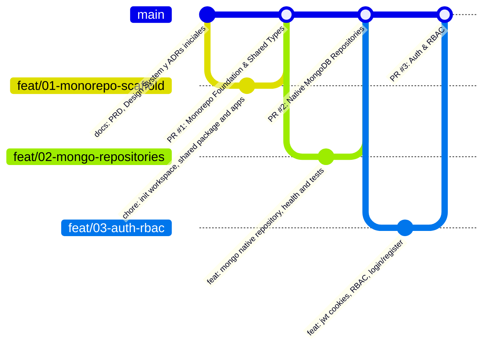
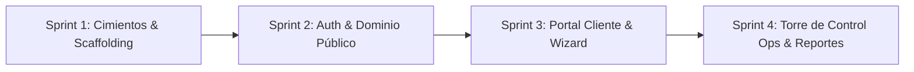

# Plan de Entrega Ágil e Incremental — EnvíoYa App

> **Objetivo:** Estructurar el desarrollo en **Sprints ágiles e incrementales**, organizados mediante ramas de características (*feature branches*) y Pull Requests (PRs) con trazabilidad clara, mensajes convencionales y criterios de aceptación verificables para un portfolio profesional de alto impacto.
> **Estado (2026-11-14):** PR #1, PR #2 y PR #3 mergeadas en `main`. El alcance de **PR #4** fue corregido tras una revisión EGM (ver su bloque): queda reducido a landing pública + tracking público. Los demás PRs sin cambios de alcance.

---

## 1. Estrategia de Branching y Flujo de Trabajo (GitFlow Simplificado / Trunk-Based con PRs)

Para asegurar un historial de commits limpio y profesional:
* **Rama Principal:** `main` (producción / código estable y documentado).
* **Ramas de Características:** `feat/<id>-<nombre-corto>` (ej: `feat/01-monorepo-scaffold`, `feat/02-mongo-repositories`, `feat/03-auth-rbac`).
* **Ramas de Documentación/Fixes:** `docs/<tema>` o `fix/<descripcion>`.
* **Convención de Commits:** [Conventional Commits](https://www.conventionalcommits.org/)
  * `feat:` nueva funcionalidad.
  * `fix:` corrección de errores.
  * `docs:` cambios en documentación o diagramas.
  * `test:` agregado o ajuste de pruebas.
  * `refactor:` refactorización de código sin cambios funcionales.
  * `chore:` tareas de configuración, dependencias o tooling.
* **Estructura de cada Pull Request:**
  * Título claro: `feat(scope): descripción concisa`
  * Descripción con: Contexto del cambio, qué resuelve, capturas de pantalla / evidencias de tests y checklist de aceptación.



---

## 2. Roadmap de Sprints e Incrementos

> _Leyenda: ✅ mergeado en `main` · 🔜 próximo · ⏳ pendiente_

El desarrollo se divide en **4 Sprints incrementales**, donde cada sprint entrega valor funcional autónomo y testeable:



---

### Sprint 1: Cimientos del Monorepo, Contratos y Persistencia (PR #1 y PR #2) ✅
> **Meta del Sprint:** Repositorio estructurado, compilación cruzada funcional y conexión validada con la base de datos `envioya` del TP9.

#### **PR #1: Cimientos del Monorepo y Paquete Compartido (`@envioya/shared`)** ✅
* **Rama:** `feat/01-monorepo-scaffold`
* **Alcance:**
  * Configuración de `package.json` raíz con npm workspaces (`packages/shared`, `apps/backend`, `apps/frontend`).
  * Scaffolding de `@envioya/shared` con:
    * Enums: `EstadoEnvio`, `TipoEvento`, `RolUsuario`, `TipoVehiculo`, `TipoTarifa`.
    * Interfaces: `IEnvio`, `ICliente`, `IRepartidor`, `IVehiculo`, `ISucursal`, `ITarifa`, `IEvento`.
    * Esquemas/DTOs base para cotización y login.
  * Scaffolding base de `apps/backend` (NestJS) y `apps/frontend` (React 19 + Vite + Tailwind CSS).
* **Criterios de Aceptación:**
  * `npm install` instala todas las dependencias sin conflictos.
  * `npm run build` en la raíz compila `@envioya/shared`, backend y frontend.
  * Los tokens de color y tipografía de Stitch están integrados en el `tailwind.config.js` del frontend.

#### **PR #2: Acceso a Datos MongoDB y Repositorios Tipados** ✅
* **Rama:** `feat/02-mongo-repositories`
* **Alcance:**
  * Implementación de `MongoDatabaseService` en NestJS usando el driver nativo `mongodb`.
  * Repositorios tipados para colecciones existentes del TP9: `ShipmentsRepository`, `BranchesRepository`, `ClientsRepository`, `FleetRepository`, `PricingRepository`.
  * Creación y migración de la colección `usuarios` con índice único por email.
  * Script o seed de verificación que conecta a MongoDB y comprueba que lee los datos preexistentes del TP9 sin tocar sus validators.
* **Criterios de Aceptación:**
  * Tests de integración que comprueban conexión y lectura de colecciones existentes.
  * Validador nativo funcional para `usuarios`.

---

### Sprint 2: Autenticación, RBAC y Vistas Públicas (PR #3 ✅ y PR #4 🔜)
> **Meta del Sprint:** Registro/login seguro con cookies (PR #3) y tracking público con Leaflet (PR #4). El ruteo vial con OSRM llega en PR #5.

#### **PR #3: Módulo de Autenticación, JWT Cookies y RBAC** ✅
* **Rama:** `feat/03-auth-rbac`
* **Alcance:**
  * Backend: Endpoints `POST /api/auth/register`, `POST /api/auth/login`, `POST /api/auth/logout`, `GET /api/auth/me`.
  * Hashing de contraseñas con `bcrypt` (12 rounds).
  * Emisión de cookie `HttpOnly`, `SameSite=Lax`. Guards de autorización por roles (`@Roles('cliente')`, `@Roles('operador')`).
  * Frontend: `AuthContext` en React, páginas de Login y Registro adaptadas de los archivos Stitch [03-login.html](design/stitch/03-login.html) y [04-register.html](design/stitch/04-register.html).
* **Criterios de Aceptación:**
  * Un usuario puede registrarse y queda autenticado con cookie HttpOnly.
  * Redirección automática según rol (`cliente` va a su dashboard, `operador` a torre de control).

#### **PR #4: Landing Pública y Tracking con Leaflet** 🔜
* **Rama:** `feat/04-public-tracking-landing`
* **Alcance:**
  * Landing Page pública adaptada de [01-landing.html](design/stitch/01-landing.html): hero con buscador de tracking y contenido. El CTA «Cotizar envío» redirige a `/registro` hasta PR #5/#6 (todavía no hay cotizador).
  * Endpoint público `GET /api/shipments/track/:code` (solo código legible `^EY-[A-Z0-9]{6}$`, sin búsqueda por `_id`) con respuesta **sin PII** (código, estado, fechas, totales, ciudades origen/destino y últimos 5 eventos desde `envios.ultimosEventos`).
  * Seguridad del endpoint: formato validado, mensaje idéntico para código inválido e inexistente, rate limit por IP y caché HTTP.
  * Vista de Tracking responsive (desktop y móvil) con timeline desde `envios.ultimosEventos` y mapa Leaflet con marcadores origen/destino (polilínea recta punteada hasta que `GeoService`/OSRM exista en PR #5), adaptada de [02-tracking.html](design/stitch/02-tracking.html) y [15-mobile-tracking.html](design/stitch/15-mobile-tracking.html).
* **Criterios de Aceptación:**
  * `GET /api/shipments/track/EY-4F8A1C` responde 200 **sin exponer** `remitente`, `destinatario`, `clienteResumen` ni `costo` (test con aserción negativa).
  * Código con formato inválido → 400; código inexistente → 404 con mensaje idéntico al de formato inválido.
  * Timeline con los 5 eventos de `ultimosEventos` ordenados por `timestamp`.
  * Usable a 360px; foco visible y contraste AA en la landing.
  * `npm run build` y `npm test` en verde con MongoDB activo.
* **Fuera de alcance:** cotizador y ruta vial OSRM (PR #5), sucursales (salvo si se agrega un `GET /api/branches` mínimo), GPS en vivo, búsqueda por `_id`.

---

### Sprint 3: Portal del Cliente y Wizard de Creación de Envíos (PR #5 y PR #6) ⏳
> **Meta del Sprint:** Flujo end-to-end para clientes particulares y empresas: cotización polinómica en tiempo real, creación y gestión de paquetes.

#### **PR #5: Motor de Cotización y Geocodificación / Ruteo**
* **Rama:** `feat/05-pricing-engine-geo`
* **Alcance:**
  * Módulo `GeoService` con integración a Nominatim + OSRM, con caché en memoria y fallback por fórmula de Haversine (ADR-005).
  * Módulo `PricingService` con cálculo polinómico: Tarifa base + Distancia (km) + Peso (kg) + Seguro/Valor declarado + Adicional Frágil.
  * Endpoint `POST /api/pricing/quote`.
* **Criterios de Aceptación:**
  * Cálculo dinámico de cotización en menos de 200 ms (con caché) y funcionamiento continuo aún desconectado mediante fallback.

#### **PR #6: Wizard de Envíos en 3 Pasos y Dashboard del Cliente**
* **Rama:** `feat/06-client-portal-wizard`
* **Alcance:**
  * Wizard interactivo de 3 pasos en React:
    1. Paso 1: Origen y destino con cálculo de ruta ([06-wizard-step1.html](design/stitch/06-wizard-step1.html)).
    2. Paso 2: Paquetes, peso, volumen y switch de fragilidad ([07-wizard-step2.html](design/stitch/07-wizard-step2.html)).
    3. Paso 3: Desglose de cotización y confirmación ([08-wizard-step3.html](design/stitch/08-wizard-step3.html)).
  * Dashboard de cliente ([05-client-dashboard.html](design/stitch/05-client-dashboard.html)), tabla de envíos con filtros ([09-client-shipments.html](design/stitch/09-client-shipments.html)) y detalle con remito y modal de cancelación ([10-client-shipment-detail.html](design/stitch/10-client-shipment-detail.html)).
* **Criterios de Aceptación:**
  * Un cliente puede crear un envío y verlo de inmediato en su historial en estado `pendiente`.
  * Puede cancelar un envío propio en estado `pendiente` especificando el motivo obligatorio.

---

### Sprint 4: Torre de Control Operativa, Asignación y Métricas (PR #7 y PR #8) ⏳
> **Meta del Sprint:** Back-office logístico completo para despachadores y operadores con máquina de estados finita y analíticas MongoDB.

#### **PR #7: Torre de Control, Asignación de Recursos y Despacho**
* **Rama:** `feat/07-ops-control-tower`
* **Alcance:**
  * Panel de Operaciones ([11-ops-dashboard.html](design/stitch/11-ops-dashboard.html)) y Bandeja de Envíos con filtros rápidos por estado y sucursal ([12-ops-shipments.html](design/stitch/12-ops-shipments.html)).
  * Panel de detalle y asignación ([13-ops-detail-assignment.html](design/stitch/13-ops-detail-assignment.html)):
    * Asignación de chofer (`repartidores`) y vehículo (`vehiculos`) con control de capacidad en kg.
    * Transición de estados mediante máquina de estados estricta (ADR-004): `Despachar`, `Registrar Incidencia`, `Entregar`.
    * Registro de eventos inmutables en MongoDB.
* **Criterios de Aceptación:**
  * Un operador no puede ejecutar transiciones de estado ilegales.
  * La asignación de recursos actualiza la capacidad del vehículo y el estado operativo del chofer.

#### **PR #8: Reportes y Métricas Operativas con Agregaciones MongoDB**
* **Rama:** `feat/08-ops-reports-aggregations`
* **Alcance:**
  * Módulo `ReportsModule` en NestJS con pipelines de agregación nativos de MongoDB (`$group`, `$match`, `$facet`, `$sort`).
  * Pantalla de Reportes ([14-ops-reports.html](design/stitch/14-ops-reports.html)) con gráficos (envíos por sucursal, tiempos promedio, top repartidores, donut por estado).
  * Exportación de envíos filtrados a formato CSV.
* **Criterios de Aceptación:**
  * Las métricas coinciden con los datos reales en la base de datos `envioya`.
  * La descarga de CSV se genera limpiamente en streaming.

---

## 2.5 Riesgos y supuestos del roadmap

- **Base de datos:** se reutiliza `envioya` del TP9 tal cual; los índices ya están creados por el seed (incl. `ux_envios_codigo` único en `envios.codigo`). No se tocan validators `$jsonSchema`.
- **Cobertura de datos para el hito público:** `envios.multimos` viene poblado por el seed con los últimos 5 eventos y `totalEventos`; `eventos_seguimiento` guarda el historial completo por buckets diarios (con `ubicacion`), reservado para la Torre de Control (PR #7).
- **Geocodificación:** las direcciones y las sucursales **no** tienen `coordenadas`; el mapa de PR #4 usa constantes de coordenadas aproximadas rotuladas como tales, o el ruteo vial se pospone a PR #5 (Nominatim + OSRM, ADR-005).
- **Seguridad del tracking público:** respuesta sin PII; rate limit por IP; mensaje idéntico para código inválido e inexistente; `_id` solo de uso interno.
- **Pendientes del producto:** despliegue (P-003) y alcance de reportes (P-006) siguen en [`decisions/decision-log.md`](decisions/decision-log.md).

---

## 3. Matriz de PRs

| PR # | Rama | Incremento | Entregable clave | Estado |
|---|---|---|---|---|
| **#1** | `feat/01-monorepo-scaffold` | Monorepo, Workspaces y `@envioya/shared` | Build ok en monorepo, contratos tipados y Tailwind | ✅ Mergeado |
| **#2** | `feat/02-mongo-repositories` | Mongo nativo y repositorios tipados | Repositorios sobre datos TP9 + `db:seed`/`db:verify` + colección `usuarios` | ✅ Mergeado |
| **#3** | `feat/03-auth-rbac` | Auth JWT y RBAC | Registro/login, cookie `envioya_session` httpOnly, guards por rol, redirect por rol | ✅ Mergeado |
| **#4** | `feat/04-public-tracking-landing` | Landing + tracking público | Código `EY-…`, DTO sin PII, timeline desde `multimos`, mapa Leaflet | 🔜 |
| **#5** | `feat/05-pricing-engine-geo` | Cotizador y geocodificación OSM | Cálculo por factores con fallback Haversine (ADR-005) | ⏳ |
| **#6** | `feat/06-client-portal-wizard` | Portal cliente y wizard | Creación de envíos, remito y cancelación lógica | ⏳ |
| **#7** | `feat/07-ops-control-tower` | Torre de control | FSM estricta, asignación, capacidad kg y eventos inmutables | ⏳ |
| **#8** | `feat/08-ops-reports-aggregations` | Reportes y exportación CSV | Agregaciones `$group/$facet` + KPIs | ⏳ |

> Nota: la numeración interna de esta tabla no coincide con la de los PRs en GitHub; ver `git log --oneline --graph --all` para la traza exacta.

---

## 4. Configuración del Repositorio Git Local y Remoto

> **Estado:** pasos ya ejecutados (`main` actualizado). Se conserva como referencia del proceso.

1. Inicializar git localmente en `envioya-app/`:
   ```bash
   git init
   git branch -M main
   ```
2. Crear un `.gitignore` completo para monorepos Node.js (`node_modules`, `dist`, `.env`, `.cache`).
3. Commit inicial de documentación y base de diseño:
   ```bash
   git add docs/ .gitignore README.md
   git commit -m "docs: formalize PRD, Stitch UI system, ADRs and agile roadmap"
   ```
4. Vincular con GitHub:
   * Repositorio remoto: `mateolujan13-dotcom/EnviosYa` (`origin`).
   * Cada feature branch se mergea a `main` mediante Pull Request documentado, con tests en verde y trazabilidad.
