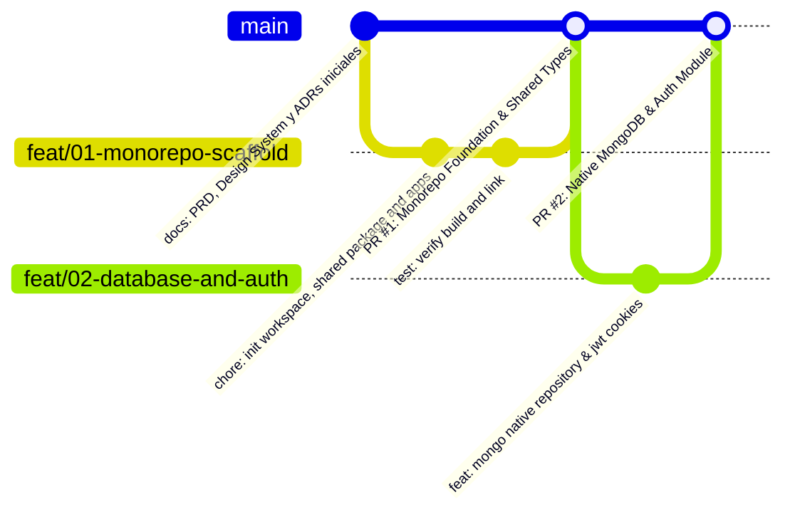
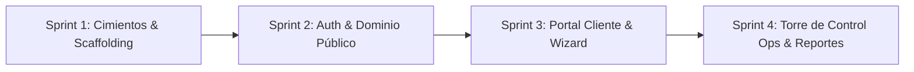

# Plan de Entrega Ágil e Incremental — EnvíoYa App

> **Objetivo:** Estructurar el desarrollo en **Sprints ágiles e incrementales**, organizados mediante ramas de características (*feature branches*) y Pull Requests (PRs) con trazabilidad clara, mensajes convencionales y criterios de aceptación verificables para un portfolio profesional de alto impacto.

---

## 1. Estrategia de Branching y Flujo de Trabajo (GitFlow Simplificado / Trunk-Based con PRs)

Para asegurar un historial de commits limpio y profesional:
* **Rama Principal:** `main` (producción / código estable y documentado).
* **Ramas de Características:** `feat/<id>-<nombre-corto>` (ej: `feat/01-monorepo-scaffold`, `feat/02-auth-rbac`).
* **Ramas de Documentación/Fixes:** `docs/<tema>` o `fix/<descripcion>`.
* **Convención de Commits:** [Conventional Commits](https://www.conventionalcommits.org/)
  * `feat:` nueva funcionalidad.
  * `fix:` corrección de errores.
  * `docs:` cambios en documentación o diagramas.
  * `test:` agregado o ajuste de pruebas.
  * `refactor:` refactorización de código sin cambios funcionales.
  * `chore:` tareas de configuración, dependencias o tooling.
* **Estructura de cada Pull Request:**
  * Título claro: `feat(scope): descripción concisa`
  * Descripción con: Contexto del cambio, qué resuelve, capturas de pantalla / evidencias de tests y checklist de aceptación.



---

## 2. Roadmap de Sprints e Incrementos

El desarrollo se divide en **4 Sprints incrementales**, donde cada sprint entrega valor funcional autónomo y testeable:



---

### Sprint 1: Cimientos del Monorepo, Contratos y Persistencia (PR #1 y PR #2)
> **Meta del Sprint:** Repositorio estructurado, compilación cruzada funcional y conexión validada con la base de datos `envioya` del TP9.

#### **PR #1: Cimientos del Monorepo y Paquete Compartido (`@envioya/shared`)**
* **Rama:** `feat/01-monorepo-scaffold`
* **Alcance:**
  * Configuración de `package.json` raíz con npm workspaces (`packages/shared`, `apps/backend`, `apps/frontend`).
  * Scaffolding de `@envioya/shared` con:
    * Enums: `EstadoEnvio`, `TipoEvento`, `RolUsuario`, `TipoVehiculo`, `TipoTarifa`.
    * Interfaces: `IEnvio`, `ICliente`, `IRepartidor`, `IVehiculo`, `ISucursal`, `ITarifa`, `IEvento`.
    * Esquemas/DTOs base para cotización y login.
  * Scaffolding base de `apps/backend` (NestJS) y `apps/frontend` (React 19 + Vite + Tailwind CSS).
* **Criterios de Aceptación:**
  * `npm install` instala todas las dependencias sin conflictos.
  * `npm run build` en la raíz compila `@envioya/shared`, backend y frontend.
  * Los tokens de color y tipografía de Stitch están integrados en el `tailwind.config.js` del frontend.

#### **PR #2: Acceso a Datos MongoDB y Repositorios Tipados**
* **Rama:** `feat/02-mongo-repositories`
* **Alcance:**
  * Implementación de `MongoDatabaseService` en NestJS usando el driver nativo `mongodb`.
  * Repositorios tipados para colecciones existentes del TP9: `ShipmentsRepository`, `BranchesRepository`, `ClientsRepository`, `FleetRepository`, `PricingRepository`.
  * Creación y migración de la colección `usuarios` con índice único por email.
  * Script o seed de verificación que conecta a MongoDB y comprueba que lee los datos preexistentes del TP9 sin tocar sus validators.
* **Criterios de Aceptación:**
  * Tests de integración que comprueban conexión y lectura de colecciones existentes.
  * Validador nativo funcional para `usuarios`.

---

### Sprint 2: Autenticación, RBAC y Vistas Públicas (PR #3 y PR #4)
> **Meta del Sprint:** Registro/login seguro con cookies y módulo de tracking público interactivo con OpenStreetMap.

#### **PR #3: Módulo de Autenticación, JWT Cookies y RBAC**
* **Rama:** `feat/03-auth-rbac`
* **Alcance:**
  * Backend: Endpoints `POST /api/auth/register`, `POST /api/auth/login`, `POST /api/auth/logout`, `GET /api/auth/me`.
  * Hashing de contraseñas con `bcrypt` (12 rounds).
  * Emisión de cookie `HttpOnly`, `SameSite=Lax`. Guards de autorización por roles (`@Roles('cliente')`, `@Roles('operador')`).
  * Frontend: `AuthContext` en React, páginas de Login y Registro adaptadas de los archivos Stitch [03-login.html](file:///c:/Users/Itu/Downloads/tp9/envioya-app/docs/design/stitch/03-login.html) y [04-register.html](file:///c:/Users/Itu/Downloads/tp9/envioya-app/docs/design/stitch/04-register.html).
* **Criterios de Aceptación:**
  * Un usuario puede registrarse y queda autenticado con cookie HttpOnly.
  * Redirección automática según rol (`cliente` va a su dashboard, `operador` a torre de control).

#### **PR #4: Vistas Públicas y Tracking con OpenStreetMap**
* **Rama:** `feat/04-public-tracking-landing`
* **Alcance:**
  * Landing Page pública interactiva (hero, cotizador rápido, sucursales) adaptada de [01-landing.html](file:///c:/Users/Itu/Downloads/tp9/envioya-app/docs/design/stitch/01-landing.html).
  * Endpoint público `GET /api/shipments/track/:code` (búsqueda por código legible `EY-4F8A1C` o `_id`).
  * Vista de Tracking responsive (desktop y móvil) con timeline de eventos y mapa interactivo Leaflet/OSRM adaptada de [02-tracking.html](file:///c:/Users/Itu/Downloads/tp9/envioya-app/docs/design/stitch/02-tracking.html) y [15-mobile-tracking.html](file:///c:/Users/Itu/Downloads/tp9/envioya-app/docs/design/stitch/15-mobile-tracking.html).
* **Criterios de Aceptación:**
  * Cualquiera puede consultar un envío sin estar logueado.
  * Visualización precisa del timeline y de la ruta entre origen y destino.

---

### Sprint 3: Portal del Cliente y Wizard de Creación de Envíos (PR #5 y PR #6)
> **Meta del Sprint:** Flujo end-to-end para clientes particulares y empresas: cotización polinómica en tiempo real, creación y gestión de paquetes.

#### **PR #5: Motor de Cotización y Geocodificación / Ruteo**
* **Rama:** `feat/05-pricing-engine-geo`
* **Alcance:**
  * Módulo `GeoService` con integración a Nominatim + OSRM, con caché en memoria y fallback por fórmula de Haversine (ADR-005).
  * Módulo `PricingService` con cálculo polinómico: Tarifa base + Distancia (km) + Peso (kg) + Seguro/Valor declarado + Adicional Frágil.
  * Endpoint `POST /api/pricing/quote`.
* **Criterios de Aceptación:**
  * Cálculo dinámico de cotización en menos de 200 ms (con caché) y funcionamiento continuo aún desconectado mediante fallback.

#### **PR #6: Wizard de Envíos en 3 Pasos y Dashboard del Cliente**
* **Rama:** `feat/06-client-portal-wizard`
* **Alcance:**
  * Wizard interactivo de 3 pasos en React:
    1. Paso 1: Origen y destino con cálculo de ruta ([06-wizard-step1.html](file:///c:/Users/Itu/Downloads/tp9/envioya-app/docs/design/stitch/06-wizard-step1.html)).
    2. Paso 2: Paquetes, peso, volumen y switch de fragilidad ([07-wizard-step2.html](file:///c:/Users/Itu/Downloads/tp9/envioya-app/docs/design/stitch/07-wizard-step2.html)).
    3. Paso 3: Desglose de cotización y confirmación ([08-wizard-step3.html](file:///c:/Users/Itu/Downloads/tp9/envioya-app/docs/design/stitch/08-wizard-step3.html)).
  * Dashboard de cliente ([05-client-dashboard.html](file:///c:/Users/Itu/Downloads/tp9/envioya-app/docs/design/stitch/05-client-dashboard.html)), tabla de envíos con filtros ([09-client-shipments.html](file:///c:/Users/Itu/Downloads/tp9/envioya-app/docs/design/stitch/09-client-shipments.html)) y detalle con remito y modal de cancelación ([10-client-shipment-detail.html](file:///c:/Users/Itu/Downloads/tp9/envioya-app/docs/design/stitch/10-client-shipment-detail.html)).
* **Criterios de Aceptación:**
  * Un cliente puede crear un envío y verlo de inmediato en su historial en estado `pendiente`.
  * Puede cancelar un envío propio en estado `pendiente` especificando el motivo obligatorio.

---

### Sprint 4: Torre de Control Operativa, Asignación y Métricas (PR #7 y PR #8)
> **Meta del Sprint:** Back-office logístico completo para despachadores y operadores con máquina de estados finita y analíticas MongoDB.

#### **PR #7: Torre de Control, Asignación de Recursos y Despacho**
* **Rama:** `feat/07-ops-control-tower`
* **Alcance:**
  * Panel de Operaciones ([11-ops-dashboard.html](file:///c:/Users/Itu/Downloads/tp9/envioya-app/docs/design/stitch/11-ops-dashboard.html)) y Bandeja de Envíos con filtros rápidos por estado y sucursal ([12-ops-shipments.html](file:///c:/Users/Itu/Downloads/tp9/envioya-app/docs/design/stitch/12-ops-shipments.html)).
  * Panel de detalle y asignación ([13-ops-detail-assignment.html](file:///c:/Users/Itu/Downloads/tp9/envioya-app/docs/design/stitch/13-ops-detail-assignment.html)):
    * Asignación de chofer (`repartidores`) y vehículo (`vehiculos`) con control de capacidad en kg.
    * Transición de estados mediante máquina de estados estricta (ADR-004): `Despachar`, `Registrar Incidencia`, `Entregar`.
    * Registro de eventos inmutables en MongoDB.
* **Criterios de Aceptación:**
  * Un operador no puede ejecutar transiciones de estado ilegales.
  * La asignación de recursos actualiza la capacidad del vehículo y el estado operativo del chofer.

#### **PR #8: Reportes y Métricas Operativas con Agregaciones MongoDB**
* **Rama:** `feat/08-ops-reports-aggregations`
* **Alcance:**
  * Módulo `ReportsModule` en NestJS con pipelines de agregación nativos de MongoDB (`$group`, `$match`, `$facet`, `$sort`).
  * Pantalla de Reportes ([14-ops-reports.html](file:///c:/Users/Itu/Downloads/tp9/envioya-app/docs/design/stitch/14-ops-reports.html)) con gráficos (envíos por sucursal, tiempos promedio, top repartidores, donut por estado).
  * Exportación de envíos filtrados a formato CSV.
* **Criterios de Aceptación:**
  * Las métricas coinciden con los datos reales en la base de datos `envioya`.
  * La descarga de CSV se genera limpiamente en streaming.

---

## 3. Matriz de Seguimiento de Pull Requests

| PR # | Rama | Incremento Funcional | Entregable Clave |
|---|---|---|---|
| **#1** | `feat/01-monorepo-scaffold` | Monorepo, Workspaces y `@envioya/shared` | Build exitoso en monorepo, contratos tipados y Tailwind listo. |
| **#2** | `feat/02-mongo-repositories` | Conector MongoDB y Repositorios Tipados | CRUD base sobre datos reales del TP9 + colección `usuarios`. |
| **#3** | `feat/03-auth-rbac` | Auth JWT Cookies + Login / Registro | Sesión segura, RBAC y vistas de acceso público y privado. |
| **#4** | `feat/04-public-tracking-landing` | Landing Page y Tracking Público | Búsqueda por código legible, mapa Leaflet y timeline responsive. |
| **#5** | `feat/05-pricing-engine-geo` | Cotizador y Geocodificación OpenStreetMap | Cálculo polinómico dinámico con fallback Haversine. |
| **#6** | `feat/06-client-portal-wizard` | Portal Cliente y Wizard 3 Pasos | Creación completa de envíos, remito y cancelación lógica. |
| **#7** | `feat/07-ops-control-tower` | Torre de Control y Máquina de Estados | Asignación de flota, control de peso kg y despacho seguro. |
| **#8** | `feat/08-ops-reports-aggregations` | Reportes Operativos y Exportación CSV | Pipelines de agregación analítica y visualización de KPIs. |

---

## 4. Configuración del Repositorio Git Local y Remoto

1. Inicializar git localmente en `envioya-app/`:
   ```bash
   git init
   git branch -M main
   ```
2. Crear un `.gitignore` completo para monorepos Node.js (`node_modules`, `dist`, `.env`, `.turbo`, `.cache`).
3. Commit inicial de documentación y base de diseño:
   ```bash
   git add docs/ .gitignore README.md
   git commit -m "docs: formalize PRD, Stitch UI system, ADRs and agile roadmap"
   ```
4. Vincular con GitHub:
   * Puedes vincularlo con tu repositorio remoto de GitHub (`git remote add origin <url>`).
   * Crearemos cada feature branch, implementaremos su código con sus pruebas, y prepararemos el Pull Request documentado para mergear a `main`.
