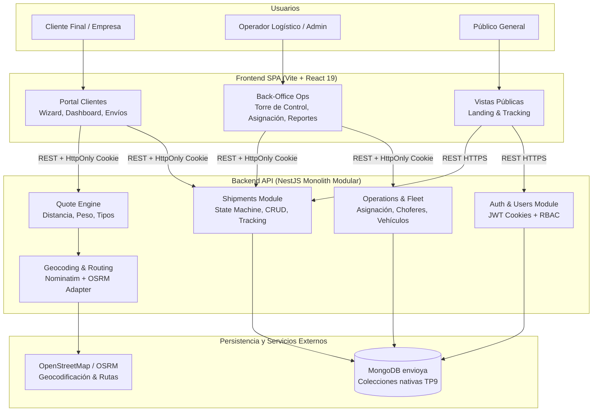

# Arquitectura del Sistema — EnvíoYa App

> **Versión:** 1.0  
> **Fecha:** 2026-11-12  
> **Stack Core:** NestJS (Backend API) + React 19 / Vite (Frontend SPA) + MongoDB Native Driver (Base de datos documental) + Tailwind CSS v3

---

## 1. Visión General y Objetivos

EnvíoYa es una plataforma integral de logística y paquetería urbana e interurbana en Argentina. La solución combina un **Portal Público** (landing y tracking), un **Portal de Clientes** (cotización en 3 pasos, gestión de envíos y remitos) y un **Back-Office Operativo de Torre de Control** (despachos, asignación de choferes/vehículos, control de capacidad en kg y reportes operativos).

### Diagrama de Contexto y Contenedores (C4)



---

## 2. Decisiones de Arquitectura Registradas (ADRs)

| ADR | Título | Estado |
|---|---|---|
| [ADR-001](file:///c:/Users/Itu/Downloads/tp9/envioya-app/docs/decisions/ADR-001-monorepo-structure.md) | Estructura de Monorepo con npm/pnpm Workspaces y Paquete Compartido (`@envioya/shared`) | **Aprobada** |
| [ADR-002](file:///c:/Users/Itu/Downloads/tp9/envioya-app/docs/decisions/ADR-002-mongodb-data-access.md) | Acceso a Datos con Driver Oficial de MongoDB y Patrón Repositorio Tipado | **Aprobada** |
| [ADR-003](file:///c:/Users/Itu/Downloads/tp9/envioya-app/docs/decisions/ADR-003-auth-and-rbac.md) | Autenticación Híbrida: JWT Stateless en Cookies HttpOnly con RBAC y Colección `usuarios` | **Aprobada** |
| [ADR-004](file:///c:/Users/Itu/Downloads/tp9/envioya-app/docs/decisions/ADR-004-shipment-state-machine.md) | Máquina de Estados Finita del Envío y Trazabilidad Documental Inmutable | **Aprobada** |
| [ADR-005](file:///c:/Users/Itu/Downloads/tp9/envioya-app/docs/decisions/ADR-005-external-geocoding-routing.md) | Integración con OpenStreetMap (Nominatim + OSRM) con Resiliencia y Caché | **Aprobada** |

---

## 3. Estructura del Repositorio (Monorepo)

```text
envioya-app/
├── package.json               # Raíz del workspace (pnpm/npm)
├── packages/
│   └── shared/                # Tipos DTO, contratos, enums y constantes compartidas
│       ├── src/
│       │   ├── enums/         # EstadoEnvio, RolUsuario, TipoVehiculo, etc.
│       │   ├── interfaces/    # IEnvio, IUsuario, ISucursal, IEvento
│       │   └── dtos/          # Validaciones y schemas (Zod o class-validator)
│       └── package.json
├── apps/
│   ├── backend/               # NestJS 10+ Modular API
│   │   ├── src/
│   │   │   ├── modules/
│   │   │   │   ├── auth/      # Login, registro, guards, jwt strategies
│   │   │   │   ├── shipments/ # CRUD, transiciones de estado, remitos
│   │   │   │   ├── pricing/   # Cotizador polinómico
│   │   │   │   ├── fleet/     # Vehículos, choferes, capacidad
│   │   │   │   ├── geo/       # Adaptador OSRM / Nominatim
│   │   │   │   └── reports/   # Agregaciones operativas MongoDB
│   │   │   └── database/      # MongoService, repositorios tipados
│   │   └── package.json
│   └── frontend/              # React 19 + Vite + Tailwind CSS
│       ├── src/
│       │   ├── components/    # UI Atómica basada en Google Stitch
│       │   ├── pages/
│       │   │   ├── public/    # Landing, Tracking público, Login, Registro
│       │   │   ├── client/    # Dashboard, Wizard 3 pasos, Mis envíos, Detalle
│       │   │   └── ops/       # Back-office: Control Tower, Asignación, Reportes
│       │   ├── context/       # AuthContext, ToastContext
│       │   └── services/      # Axios / Fetch client tipado
│       └── package.json
└── docs/                      # PRD, Stitch prompts, ADRs, esquemas
```
