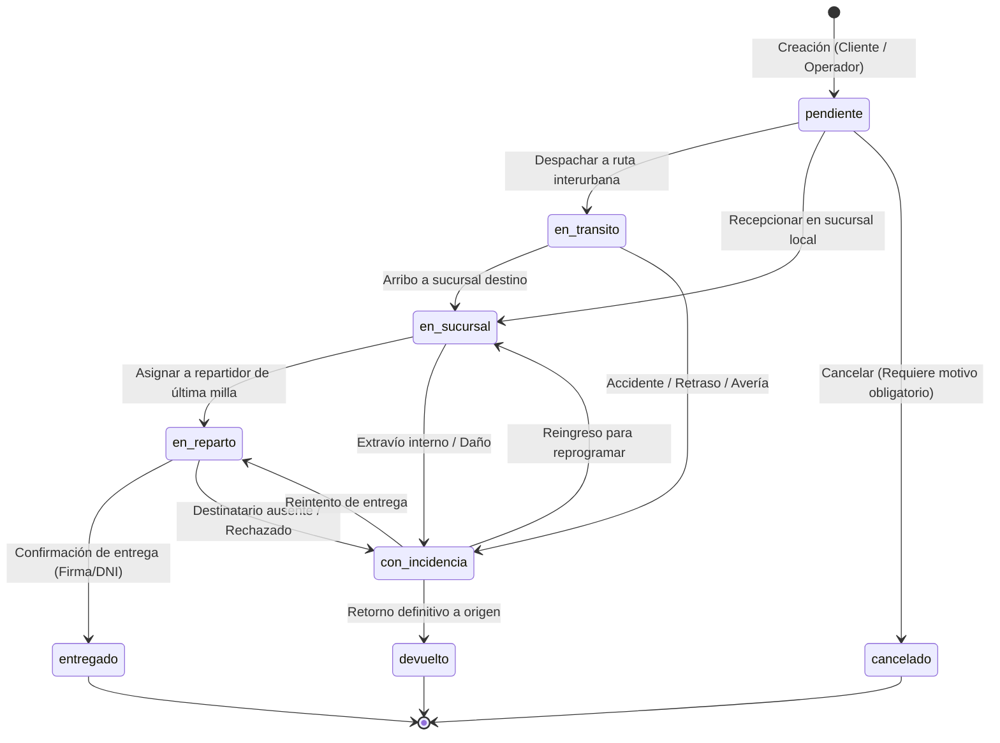

# ADR-004: Máquina de Estados Finita del Envío y Trazabilidad Documental

* **Estado:** Aprobada
* **Fecha:** 2026-11-12
* **Decisores:** Equipo de Arquitectura & Antigravity Assistant

---

## Contexto y Planteamiento del Problema (D-007)

El ciclo de vida de un envío es el corazón operativo del negocio de paquetería. En la base de datos documental del TP9, los estados de un envío están restringidos por un JSON Schema validator a:
`pendiente`, `en_transito`, `en_sucursal`, `en_reparto`, `entregado`, `con_incidencia`, `devuelto` y se incorpora `cancelado`.

Permitir transiciones de estado arbitrarias (por ejemplo, pasar de `entregado` a `pendiente` o de `creado` a `entregado` sin pasar por despacho) provocaría inconsistencias graves en el negocio, métricas corrompidas y pérdida de confianza de los usuarios.

Además, cada transición debe generar un evento inmutable en el array `eventos` del documento del envío.

---

## Opciones Consideradas

1. **Actualizaciones de campo directas (`PATCH /api/shipments/:id` con `{ estado: "..." }` libre):**
   * Cualquier operador o bug en el frontend podría forzar transiciones ilegales.
2. **Máquina de Estados Finita (FSM) estricta en el Servicio de Dominio:**
   * Tabla de transiciones permitidas con validación previa en NestJS.
   * Endpoints semánticos o método de servicio único `transitionState(envioId, nuevoEstado, metadata, usuario)` que valida permisos de rol y precondiciones.
   * Inyección atómica del evento de auditoría en el array `eventos` mediante `$push` de MongoDB.

---

## Decisión

Implementar una **Máquina de Estados Finita (FSM)** en la capa de dominio del backend (`ShipmentsStateMachine`):

### Grafo de Transiciones Permitidas



### Reglas de Negocio Clave
1. **Asignación de Recursos:** La asignación de chofer y vehículo puede ocurrir en estado `pendiente` o `en_sucursal`, pero **no cambia el estado a `en_transito` automáticamente**. El despacho físico es una acción explícita del operador ("Despachar").
2. **Cancelación Lógica:** Un envío solo puede ser cancelado por el cliente si se encuentra en estado `pendiente`. Los operadores pueden cancelar hasta antes de `en_reparto`. Toda cancelación exige un campo `motivoCancelacion` no vacío.
3. **Inmutabilidad de Eventos:** El array `eventos` de MongoDB solo se modifica agregando nuevos elementos (`$push`), asegurando una bitácora forense de auditoría inmutable:
   ```json
   {
     "tipo": "cambio_estado",
     "estado": "en_transito",
     "timestamp": "2026-11-12T14:30:00Z",
     "sucursalId": "SUC-CBA",
     "repartidorId": "REP-001",
     "observaciones": "Despachado en unidad Ford Transit hacia Rosario"
   }
   ```

---

## Consecuencias

### Positivas
* **Integridad total de los datos:** Es imposible dejar un envío en un estado corrupto o ilógico.
* **Trazabilidad 100% auditable:** Cada cambio de estado tiene timestamp, sucursal o actor responsable.
* **Interfaz amigable:** El frontend puede consultar las acciones válidas para el estado actual del envío y renderizar únicamente los botones pertinentes (ej: botón "Despachar" habilitado, "Entregar" oculto o deshabilitado).
