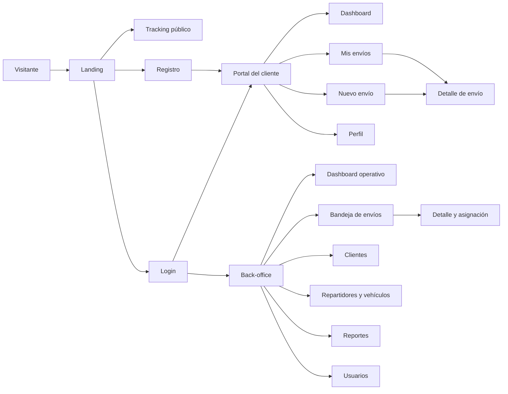
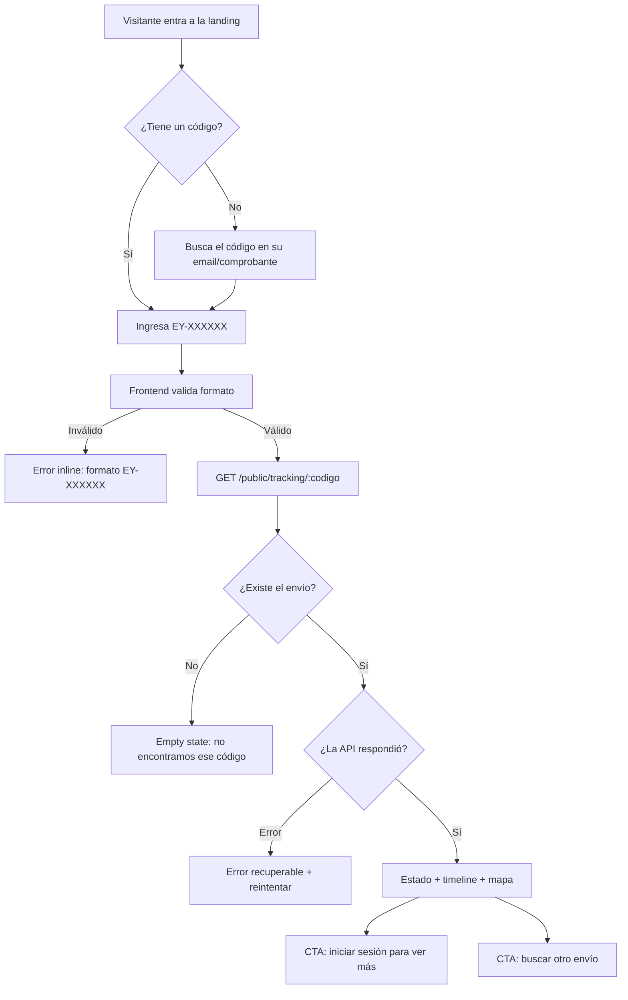
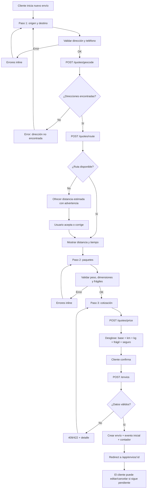
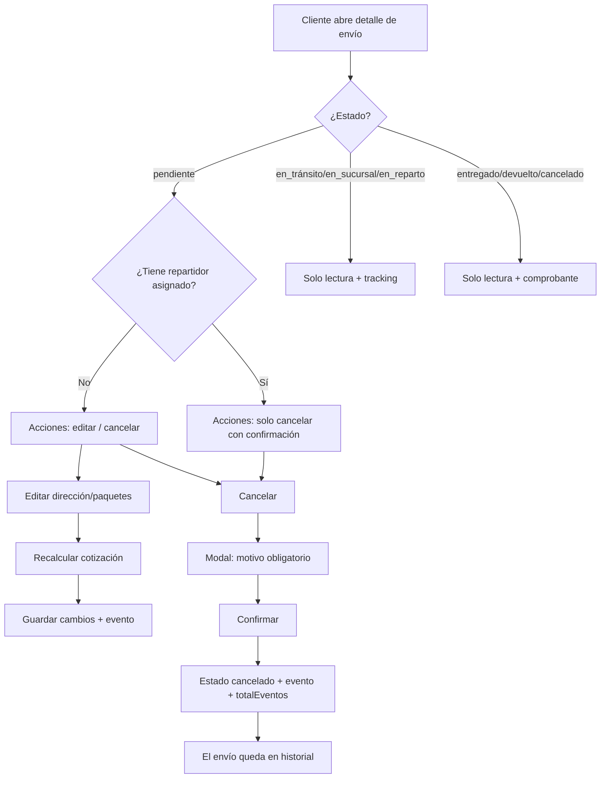
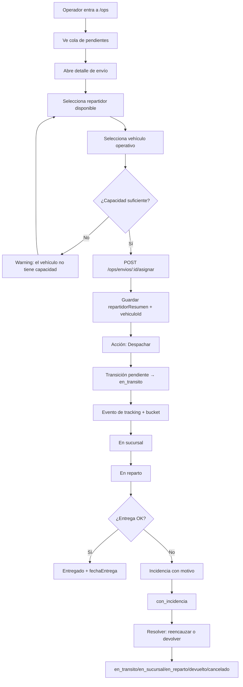
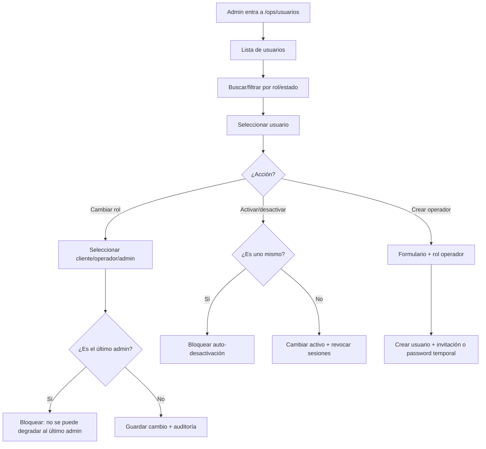
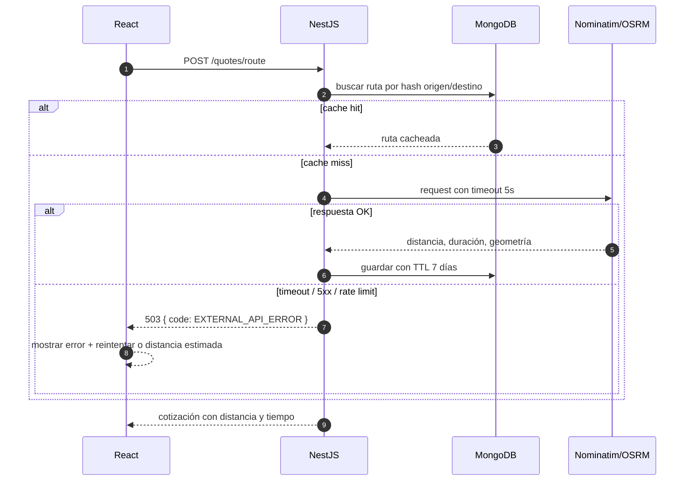
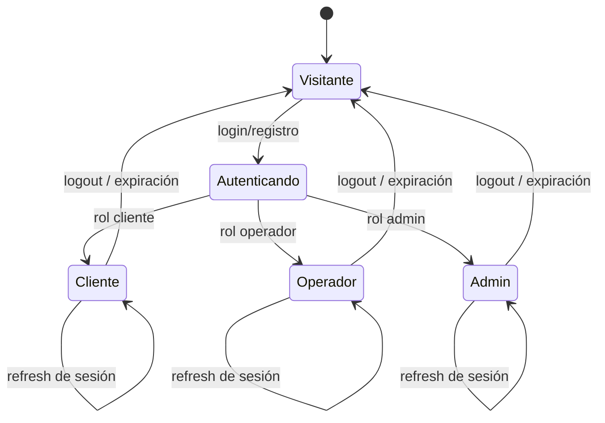

# Flujos de usuario — EnvíoYa App

> Diagramas de los recorridos principales. Complementan el PRD y los wireframes.
> Versión 0.1 · 2026-11-12

---

## 1. Mapa general por rol



---

## 2. Tracking público



**Reglas**

- El tracking público no requiere autenticación.
- Solo muestra datos no sensibles: estado, ciudad, últimos eventos, nombre del repartidor.
- Si el envío está cancelado, muestra el estado y el motivo general, no datos internos.

---

## 3. Registro y login

```mermaid
flowchart TD
  A[Visitante] --> B{¿Tiene cuenta?}
  B -- No --> C[Formulario de registro]
  C --> D[Validación frontend]
  D -- Error --> E[Errores por campo]
  E --> C
  D -- OK --> F[POST /auth/register]
  F --> G{¿Email único?}
  G -- No --> H[Error: email ya registrado]
  H --> C
  G -- Sí --> I[Crear cliente + usuario]
  I --> J[Hash de contraseña y evento de alta]
  J --> K[Login automático]
  K --> L[Redirect según rol]

  B -- Sí --> M[Formulario de login]
  M --> N[POST /auth/login]
  N --> O{¿Credenciales válidas?}
  O -- No --> P[Error genérico + rate limit]
  P --> M
  O -- Sí --> Q[Set cookies httpOnly]
  Q --> L
  L --> R{¿Rol?}
  R -- Cliente --> S[/app]
  R -- Operador/Admin --> T[/ops]
```

**Reglas**

- No revelar si el email existe en el login.
- Rate limit en login y registro.
- La sesión se guarda en cookies httpOnly; el frontend no manipula el token.
- Si el usuario está desactivado, el login responde con un mensaje genérico y no crea sesión.
- El registro crea el cliente y el usuario; si falla uno, se compensa el otro.

---

## 4. Cotización y creación de envío



**Reglas**

- La cotización se calcula en el backend.
- La cotización vale 30 minutos; si vence, se recalcula.
- El envío nace en `pendiente` y sin repartidor.
- El evento inicial es `creado` (tipo `cambio_estado`, estado `pendiente`).
- El código se genera una sola vez y es único.

---

## 5. Gestión del cliente: editar y cancelar



**Reglas**

- Editar solo si `pendiente` y sin repartidor.
- Cancelar solo si `pendiente`; el operador puede cancelar `con_incidencia` con motivo.
- Nunca se borra el documento.
- El motivo se guarda en el evento y en `observacion`.

---

## 6. Operación: asignación y transiciones



**Reglas**

- Solo se muestran transiciones válidas para el estado actual.
- Asignar no cambia el estado; despachar sí.
- Cada transición pide confirmación y, si es destructiva, motivo.
- La asignación valida sucursal, disponibilidad y capacidad.
- El operador no puede editar datos de facturación.

---

## 7. Administración de usuarios



**Reglas**

- Un admin no puede degradarse a sí mismo si es el último admin.
- Desactivar un usuario revoca sus sesiones.
- Los operadores no pueden gestionar usuarios.
- Los cambios de rol se registran en una colección de auditoría (P1).

---

## 8. Manejo de errores de la API externa



**Reglas**

- Reintento automático: 1 vez con backoff de 500 ms.
- Caché de geocodificación: 30 días; ruta: 7 días.
- Si se usa distancia estimada, se marca `estimated: true` y se muestra advertencia.
- El frontend nunca llama a OSM directamente.
- Todos los errores tienen un código estable para tests y analítica.

---

## 9. Estados de sesión y redirecciones



**Reglas**

- Cliente que intenta entrar a `/ops` → 403 + redirect a `/app`.
- Operador/admin que intenta entrar a `/app` → puede ver su perfil, pero no envíos de cliente.
- Sesión expirada → redirect a login con `returnTo`.
```
